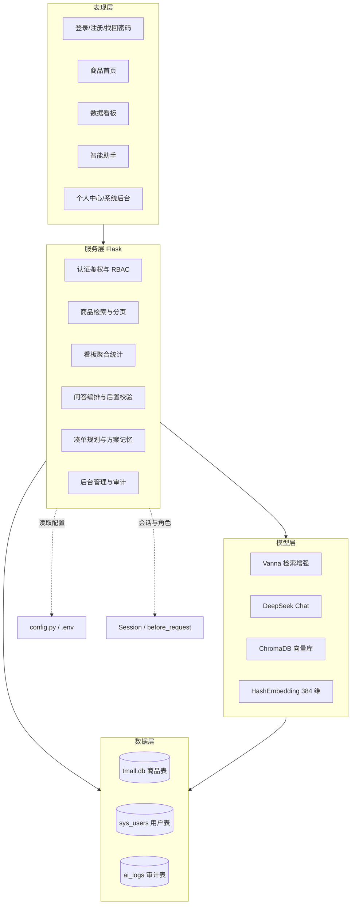
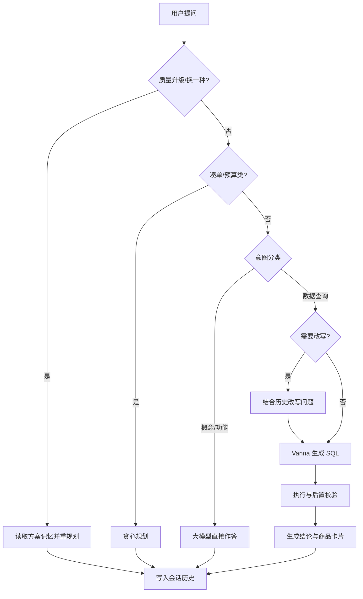
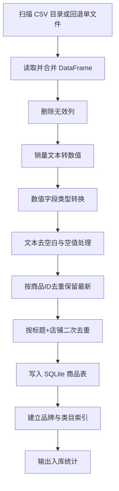
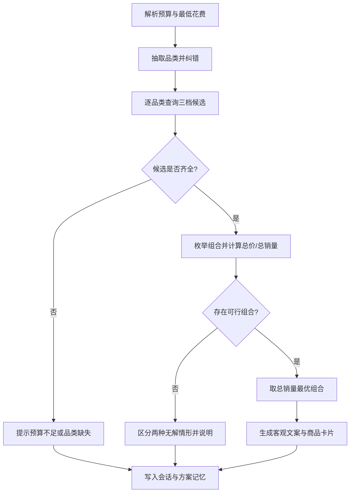
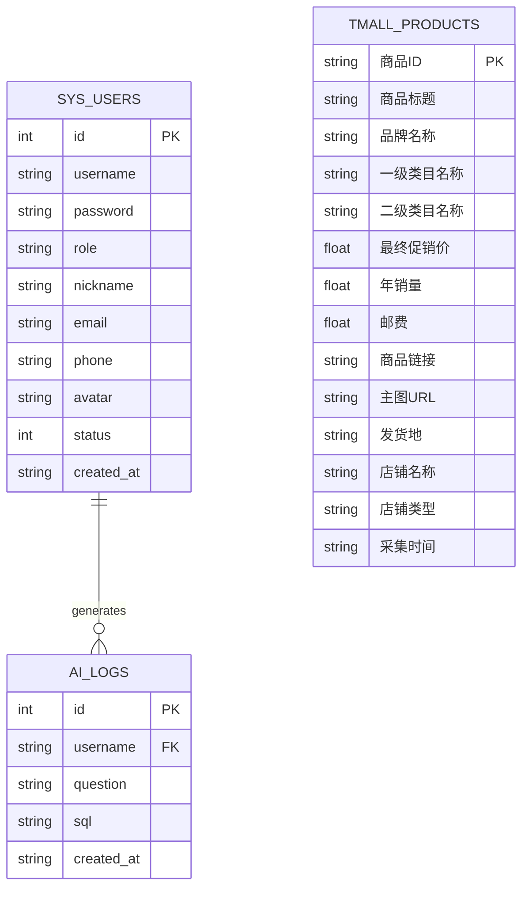

# 基于大语言模型的天猫电商大数据分析与智能助手系统设计与实现

## 摘要

随着电商平台商品规模与运营指标的持续膨胀，运营人员面对上万级商品数据时，往往需要在"看数据"与"问数据"之间反复切换工具：一方面需要直观的可视化看板掌握价格带、品牌集中度与类目结构；另一方面又希望用自然语言直接获得可执行的商品结论。传统商业智能工具依赖拖拽建模与固定报表，难以覆盖长尾、口语化的分析诉求；而单纯调用大模型又容易产生"看似合理、实则编造"的 SQL 与商品推荐。如何在二者之间建立一条可靠、可解释、可复核的工程路径，是当前"大模型 + 结构化数据"应用落地的关键问题。

本文以天猫商品数据集为研究对象，设计并实现了一个基于 Flask、Vanna、DeepSeek 与 SQLite 的电商大数据分析与智能助手平台。系统采用浏览器/服务器架构，划分为系统基础服务、商品导购服务、数据可视化服务、AI 智能问答与分析服务、系统后台服务五个功能模块，覆盖注册登录、个人中心、商品检索、数据看板、自然语言问答、凑单规划、用户管理与 AI 审计等业务。针对中文 NL2SQL 在电商场景中的稳定性问题，本文采用"向量知识库检索 + 大模型生成 + Python 后置校验"的三段式方案：以建表语句、业务文档与"问题-SQL"对构建领域知识库，通过字符 n-gram 哈希向量完成本地召回，并在 SQL 执行前后加入条数控制、极值修正、配件过滤与去重等规则。针对"凑单"这一带约束的组合优化问题，本文放弃简单按类目累加的做法，设计了"实体抽取—三档备选—贪心组合—预算逼近"的规划算法，引入类目黑名单、价格锚点与动态质量升级机制，使推荐结果在满足预算约束的同时具备基本的生活常识。系统同时引入基于角色的访问控制（RBAC），将数据看板与系统后台限定为管理员可见，并记录 AI 生成的 SQL 以便审计。

系统实测覆盖 11 889 条去重商品、3 981 个品牌与 99 个一级类目。功能测试表明：自然语言查询可正确生成并执行 SQL，商品卡片以双列富文本形式稳定呈现；凑单规划在 150 元预算、至少花 80 元的条件下给出 127.32 元的可行组合，在 300 元预算下可响应"耳机质量要好点"的动态升级指令，并在预算低于品质底线时明确拒绝凑数；权限测试表明普通用户无法访问看板与后台接口。系统在准确性、可用性、安全性与可解释性方面达到预期目标，可为中小型电商团队的智能数据分析提供参考。

**关键词**：大语言模型；NL2SQL；Vanna；电商数据分析；凑单规划；基于角色的访问控制

## Abstract

This paper presents an e-commerce data analysis and intelligent assistant platform built with Flask, Vanna, DeepSeek and SQLite. To address the instability of Chinese NL2SQL in real business scenarios, the system adopts a three-stage pipeline: retrieval-augmented domain knowledge, LLM-based SQL generation, and Python-side post-validation including limit correction, accessory filtering, deduplication and link checking. A lightweight character n-gram hashing embedding is used for local vector recall so that the system can run offline without downloading additional models. For bundle planning, a greedy algorithm with price anchors, category blacklists, box-size rules and dynamic quality upgrade is designed instead of naive price accumulation. The platform is organized into five modules and protected by role-based access control, in which dashboards and the administration console are restricted to administrators and every generated SQL statement is logged for auditing. The system is validated on a deduplicated dataset of 11,889 products, 3,981 brands and 99 first-level categories. Results show that the platform provides stable natural-language querying, interpretable SQL, constraint-satisfying bundle recommendations, and effective permission isolation.

**Keywords**: Large Language Model; NL2SQL; Vanna; E-commerce Analytics; Bundle Planning; Role-Based Access Control

---

## 目录

1 绪论
　1.1 研究背景及意义
　1.2 国内外研究现状
　1.3 研究目标与内容
　1.4 论文组织结构
2 相关技术概述
　2.1 大语言模型
　2.2 NL2SQL 技术
　2.3 Vanna 框架
　2.4 DeepSeek API
　2.5 ChromaDB 向量数据库
　2.6 Flask 与前端可视化
3 系统分析
　3.1 系统需求概述
　3.2 系统可行性分析
　3.3 功能性需求分析
　3.4 非功能性需求分析
4 系统设计
　4.1 系统设计原则
　4.2 总体架构设计
　4.3 功能模块设计
　4.4 主要业务流程设计
　4.5 数据库设计
　4.6 关键算法设计
5 系统实现
　5.1 系统开发环境与工具
　5.2 系统基础服务的实现
　5.3 数据清洗与加载模块的实现
　5.4 智能查询助手模块的实现
　5.5 智能推荐与凑单规划模块的实现
　5.6 数据看板与商品首页的实现
　5.7 系统后台服务模块的实现
　5.8 前端渲染实现
6 系统测试
　6.1 测试环境
　6.2 功能测试
　6.3 非功能测试
　6.4 典型缺陷与修复记录
7 结论
　7.1 全文总结
　7.2 研究展望
谢辞
参考文献

---

## 1 绪论

### 1.1 研究背景及意义

近年来，电子商务已经成为居民消费的主要渠道之一。平台在运营过程中沉淀了规模庞大的商品数据，这些数据既包含商品标题、品牌、类目、价格、销量等交易属性，也包含佣金、补贴、发货地、店铺类型等运营属性。对商家和平台运营人员而言，数据的价值并不在于"存了多少"，而在于能否被及时、准确地转化为决策依据。

以天猫为例，一个中等规模的店铺或类目池就可能包含上万条在售商品，每条商品又带有数十个字段。运营人员常见的诉求可以归纳为两类。第一类是结构性洞察，例如"各价格区间的商品数量如何分布""哪些品牌在铺货上最激进""哪些一级类目的均价最高""包邮商品占比多少"。这类问题维度固定、口径清晰，适合用预先设计好的可视化看板回答。第二类是长尾、口语化的取数诉求，例如"推荐 3000 元以上的手机""销量最高的品牌是哪个""我有 150 块，要买耳机、鼠标、笔记本，至少花 80，给个方案"。这类问题的维度组合几乎无穷，无法靠固定报表穷举，而要求运营人员手写 SQL 又有较高门槛：他们既要熟悉表结构，又要理解类目层级，还要反复调试去重与过滤条件。

大语言模型的出现为第二类问题提供了新的解决路径：把自然语言翻译为 SQL（NL2SQL），再执行 SQL 返回结果。大模型在语义理解、意图识别与文本生成方面表现出色，能够显著降低数据查询的使用门槛[1]。但在真实落地中，直接让模型"自由发挥"会暴露三类问题。其一，模型不熟悉业务字段与口径，容易把"手机"写成 `商品标题 LIKE '%手机%'`，从而召回手机壳、手机支架、手机贴膜等配件，导致结论失真。其二，模型对"极值""推荐几个"等数量语义不敏感，用户问"销量第一的手机"，它可能返回十条；用户说"推荐五部平板"，它可能返回十条，条数与预期不符。其三，模型在多轮对话中容易丢失上下文，用户说"换一种""那 3000 以上的呢"时无法理解指代，导致答非所问。

与此同时，"凑单"是电商场景中极具业务价值、也极易做错的一类问题。它本质上是一个带约束的组合优化问题：在预算上限与最低消费门槛之间，从多个类目中各选一件商品，使总价落入可行区间。若只用"各类目取最便宜"的简单累加，算法就会为了填满预算而选出 2 元的杯盖密封圈、5 元的半截背心和 2 元的劣质耳机——这些结果在数学上"合法"，在生活常识上却完全不可用。如何让算法既满足价格约束，又具备基本的品类常识，是本文需要解决的核心工程问题之一。

从学术角度看，现有 NL2SQL 研究多集中于模型结构、模式链接与基准评测，对生成之后的业务校验讨论相对不足；推荐系统研究则更多关注召回与排序精度，对"预算约束下的组合推荐"这一细分场景关注有限。本文尝试把大模型的语言能力与确定性工程规则结合起来：用领域知识库约束 SQL 生成，用规则引擎约束推荐结果，用权限模型约束数据访问，从而构建一个既可解释、又符合常识、还可审计的电商数据分析与导购系统。

本文的研究意义主要体现在三个方面。第一，在方法层面，提出并验证了"检索增强 + 规则后置"的 NL2SQL 稳定性方案，说明在中文电商这类强领域、强口径的场景中，工程约束比单纯扩大模型规模更有效。第二，在应用层面，将数据看板、商品检索、自然语言问答与凑单规划整合到同一平台，减少了运营人员在多个工具之间切换的成本。第三，在安全层面，引入角色权限与 AI 审计日志，为"大模型接入企业数据"提供了最小可行的治理范式。上述思路对同类"LLM + 结构化数据"的应用具有可复用的参考价值。

### 1.2 国内外研究现状

**（1）大语言模型研究。** 大语言模型以 Transformer 为基础架构，通过海量语料的自监督预训练获得通用语言理解与生成能力[2]。舒文韬等系统梳理了大型语言模型的原理、实现与发展脉络，指出规模扩展、指令微调与对齐训练是模型能力跃迁的三个关键环节[1]。Zhao 等的综述进一步从预训练、适配与评测三个维度总结了该领域的技术路线[3]。罗文等则从评测角度指出，大模型在知识密集型任务上仍存在事实性错误与评测口径不统一的问题[4]。这些研究为本文理解模型能力边界提供了基础：模型擅长语言层面的理解与表达，但在精确计算、领域口径与实时数据上并不可靠，必须由外部系统兜底。

**（2）NL2SQL 技术研究。** 早期的 NL2SQL 研究将问题视为序列到序列的翻译任务。Zhong 等提出的 Seq2SQL 将自然语言转换为 SQL 的 WHERE 子句，并通过强化学习以执行结果优化模型[7]。Yu 等发布的 Spider 数据集覆盖多库、跨域与复杂嵌套查询，推动了模式链接、值识别等方向的发展[8]。国内学者也对中文场景进行了系统总结：郑耀东等回顾了基于中文自然语言的 SQL 生成方法，指出中文分词、同义词与口语化表达是主要难点[5]；刘喜平等从语义解析视角梳理了数据库查询生成的研究进展[6]；刘雨蒙等则从示例、文本与语音三类输入出发，总结了结构化查询语言智能合成的技术路线[10]。邰伟鹏等将 BiLSTM 应用于 NL2SQL，验证了深度序列模型在中文查询上的可行性[11]。随着大模型上下文能力的提升，研究重心逐渐转向"提示工程 + 少量示例"的免训练范式，Gao 等系统比较了不同示例选择与提示组织策略对 Text-to-SQL 效果的影响[9]。

**（3）检索增强生成研究。** 大模型的知识受限于训练语料，容易产生幻觉。Lewis 等提出的检索增强生成（RAG）通过在生成前检索外部知识并拼接进上下文，显著提升了事实一致性[12]。在结构化数据场景中，RAG 的"知识"不再是文档段落，而是建表语句、字段口径说明与历史"问题-SQL"对；检索方式也由文本相似度扩展为向量相似度。这一思路为本文构建 Vanna 领域知识库提供了直接依据。

**（4）自然语言 BI 与可视化研究。** 国外已有 Text-to-SQL 商业产品与开源框架。Vanna 是其中较有代表性的开源方案：它以向量数据库存储 DDL、业务文档和"问题-SQL"样本，生成时先检索相似样本再交由大模型补全，从而实现"越用越准"的领域适配。骆昱宇等对智能数据可视分析进行了系统综述，指出自然语言交互与自动化图表生成是可视分析的重要发展方向[13]。吴宪传等设计了基于大数据的电商数据仓库可视化平台，验证了可视化看板在电商运营中的实用价值[14]。这些工作说明，"看"与"问"并非割裂的两件事，而应在同一数据底座上统一。

**（5）推荐与组合优化研究。** 电商凑单、满减凑单在运筹学中可归入带约束的背包类问题。精确求解可用动态规划或整数规划，但在"多类目、每类目多候选、还需兼顾销量"的场景下，启发式贪心因实现简单、可解释性强而被广泛采用。徐凤如等综述了基于深度学习与大语言模型的序列推荐研究进展[15]，卡祖铭等则从预训练、微调与提示三个范式总结了面向大模型的推荐系统[16]。近年也有研究将大模型用于偏好理解与推荐理由生成，但价格、库存等硬约束仍应交给确定性代码处理。

综上，现有研究与工程实践多集中在"生成 SQL"这一环节，对生成之后的业务校验、推荐结果的常识约束以及大模型访问企业数据时的权限治理讨论不足。本文正是从这三个薄弱环节切入：以规则后置提升 SQL 可用性，以价格锚点与类目黑名单提升推荐合理性，以 RBAC 与审计日志提升系统安全性。

### 1.3 研究目标与内容

本文的目标是构建一个面向天猫商品数据的分析与智能助手平台，使用户能够以自然语言完成取数、分析与购物决策，同时保证结果可控、可解释、可审计。具体研究内容包括以下五个方面。

第一，数据治理与结构化存储。完成原始 CSV 的读取、类型转换、去重、数值化与 SQLite 入库，为上层查询与统计提供一致的数据底座；针对"1.8万+"这类文本销量，设计解析规则将其转为数值，避免聚合失真。

第二，可视化分析看板与商品检索首页。以 ECharts 呈现核心指标与结构分布，包括价格区间、品牌商品数、类目均价、发货地与类目占比；提供关键词、品牌、类目、价格区间、排序等多维筛选，满足运营人员"先看整体、再下钻"的使用习惯。

第三，稳定的中文 NL2SQL 问答。构建 Vanna 领域知识库，设计意图路由、查询改写、条数控制、极值修正、配件过滤与结果去重等机制，使问答结果在中文电商语境下保持稳定，并向用户展示生成的 SQL 以支持复核。

第四，带业务约束的凑单规划。设计"实体抽取—三档备选—贪心组合—预算逼近"的规划算法，引入类目黑名单、价格锚点、整箱规则与动态质量升级，解决"为凑单而凑垃圾"的问题，并在无可行解时给出真实、可理解的解释。

第五，系统安全与测试评估。引入基于角色的访问控制，区分普通用户与管理员；记录 AI 生成的 SQL 以供审计；从功能与非功能两个维度验证系统，记录典型缺陷及其修复过程。

### 1.4 论文组织结构

全文共七章。第 1 章介绍研究背景、国内外现状、研究目标与论文结构；第 2 章概述大语言模型、NL2SQL、Vanna、DeepSeek、ChromaDB 与 Flask 等关键技术；第 3 章从可行性、角色、功能与非功能四个层面进行系统分析；第 4 章给出设计原则、总体架构、模块划分、业务流程、数据库与关键算法设计；第 5 章结合代码说明各模块的实现过程与界面效果；第 6 章给出测试环境、测试用例、非功能测试与缺陷修复记录；第 7 章总结全文并展望后续工作。

---

## 2 相关技术概述

### 2.1 大语言模型

大语言模型（Large Language Model，LLM）以 Transformer 为基础架构，通过堆叠自注意力层建模长距离依赖，并借助海量语料的自监督预训练获得通用语言能力[2]。其核心机制是自注意力：对输入序列中的每个位置，模型计算该位置与其他位置的关联权重，并据此聚合上下文信息，从而在不依赖循环结构的情况下并行处理长文本。

在应用层面，大模型通常经历三个阶段：预训练、指令微调与对齐。预训练赋予模型世界知识与语言规律；指令微调使模型学会遵循任务指令；对齐训练则通过人类反馈优化输出的有用性与安全性[1]。对本系统而言，大模型承担三类职责：意图分类（判断问题是"查数据"还是"问概念"）、SQL 生成与润色、以及将结构化结果改写为简洁自然的中文结论。

工程上需要重点关注两个参数：`temperature` 与 `max_tokens`。前者控制采样随机性，取值越低输出越确定；后者限制输出长度，避免模型生成冗长解释污染结果解析。本系统在 SQL 生成与实体抽取任务上将 `temperature` 设为 0，在文案润色任务上设为 0.2，在概念问答上设为 0.4，以兼顾稳定性与表达自然度。此外，提示词的组织方式直接影响输出质量：明确的角色设定、结构化的输出格式要求以及少量高质量示例，往往比单纯增加模型参数更有效[3]。

### 2.2 NL2SQL 技术

NL2SQL 的目标是把自然语言问题映射为可执行的 SQL。典型流程包含三步：模式链接、结构解析与 SQL 生成校验。模式链接负责识别问题中提到的实体与数据库表、字段的对应关系；结构解析负责确定 SELECT 列、聚合函数、WHERE 条件、GROUP BY 与 ORDER BY；SQL 生成校验则输出 SQL 并做语法与执行校验[5]。

从技术演进看，NL2SQL 经历了基于模板与规则、基于深度序列模型、基于预训练语言模型与基于大模型四个阶段[6]。早期方法依赖人工编写的模板，覆盖面有限；Seq2SQL 等工作引入强化学习，以执行结果作为奖励信号[7]；Spider 数据集则把评测从单表扩展到多表跨域，推动模式链接成为研究热点[8]。近年来，大模型凭借强大的语义理解与上下文学习能力，在零样本与少样本设置下取得了可观效果，Gao 等的研究表明，示例选择策略与提示组织方式对最终准确率有显著影响[9]。

中文电商场景的难点主要体现在四个方面。第一，领域同义词多，例如"电宝"指充电宝、"纸"可能指抽纸或卷纸；第二，类目与配件高度耦合，搜索"手机"极易召回手机膜、手机壳与充电线；第三，数量语义模糊，"来几个""推荐一些"没有明确条数；第四，口语化表达多，用户常说"便宜点的""质量好点的"，需要结合上下文理解。因此，纯模型方案不足，需要"知识库 + 规则"共同约束。本文正是基于这一判断设计系统。

### 2.3 Vanna 框架

Vanna 是一个开源的 Text-to-SQL 框架，核心思想是"检索增强的 SQL 生成"。其工作流程可分为训练、推理与执行三个阶段。

训练阶段，开发者将建表语句（DDL）、业务文档（documentation）与历史"问题-SQL"对写入向量库。DDL 让模型了解表结构与字段类型，业务文档补充字段口径与业务规则，"问题-SQL"对则提供可参考的示例。推理阶段，用户提问后，框架先在向量库中检索语义相近的样本，连同 DDL 一起拼入提示词，再由大模型生成 SQL。执行阶段，框架调用数据库执行 SQL，返回 DataFrame，并可选择让模型基于结果生成自然语言总结。

Vanna 的优势在于把"领域适配"从模型微调转移到了知识库维护：新增一条业务规则或示例，不需要重新训练模型，只需写入向量库即可生效。其局限在于：检索只解决"像不像"，不解决"对不对"；如果知识库本身存在口径冲突，或模型忽略了检索到的规则，生成结果仍可能出错。因此，工程侧必须增加确定性的后置校验。本系统使用了 Vanna 的 legacy Flask 集成，并将 `ChromaDB_VectorStore` 与 `OpenAI_Chat` 组合为自定义类，把大模型替换为 DeepSeek 的 OpenAI 兼容接口。

### 2.4 DeepSeek API

DeepSeek 提供与 OpenAI 协议兼容的 Chat Completions 接口，开发者通过 `openai` SDK 指定 `base_url` 与 `api_key` 即可调用，模型选用 `deepseek-chat`。其优势在于中文理解与 SQL 生成表现较好、调用成本低，适合本系统"单次请求多次模型调用"的模式——一次用户提问可能依次触发实体抽取、意图分类、查询改写、SQL 生成与文案润色五次调用。

在工程实现上，本系统将 API 密钥与基地址放入 `.env` 文件，由 `python-dotenv` 读取，避免密钥硬编码进代码仓库；同时封装统一的 `llm_text()` 函数，集中处理超时、异常与返回为空的情况。当接口不可用时，系统回退到正则解析与模板文案，保证核心功能不中断。

### 2.5 ChromaDB 向量数据库

ChromaDB 是轻量级嵌入式向量数据库，支持持久化存储与基于余弦相似度的检索。本系统将训练语料写入本地持久化目录，首次启动时按"是否已有训练数据"判断是否需要重新训练，避免每次启动重复写入向量。

需要特别说明的是嵌入函数的选择。DeepSeek 不提供 embeddings 接口，离线环境也难以直接下载 ONNX 模型，因此本系统实现了 `HashEmbeddingFunction`：对文本做字符 2-gram、3-gram、4-gram 切分，用 MD5 哈希映射到 384 维向量空间，并按哈希奇偶赋予正负权重，最后做 L2 归一化。该方案无需外部模型、无需网络，虽然语义精度不及神经网络嵌入，但对"问题-SQL"这类短文本的相似召回已足够可用，且完全可离线运行，适合作为教学与中小规模应用的折中方案。

### 2.6 Flask 与前端可视化

后端采用 Flask 提供路由、会话与 JSON 接口。Flask 轻量、灵活，便于与 Vanna 的 Flask 集成共存；通过 `before_request` 钩子可统一实现登录校验与权限拦截，通过 `session` 保存登录状态与角色信息。模板层使用 Jinja2，支持模板继承与局部渲染。

前端使用 TailwindCSS 构建深色主题界面，使用 ECharts 绘制价格区间、品牌分布、类目均价与发货地分布等图表，使用 marked.js 渲染大模型返回的文本引导语。选择 ECharts 的原因在于其图表类型丰富、配置项灵活，且对中文标签与响应式布局支持良好。商品列表则由 JavaScript 模板字符串自行渲染，从而保证卡片样式可控、可测试，避免模型输出不稳定的 HTML 破坏页面结构。

---
## 3 系统分析

### 3.1 系统需求概述

系统面向电商运营人员、数据分析人员与店铺管理者，围绕"看、查、问、算、管"五类活动组织功能。"看"指通过数据看板掌握整体结构与关键指标；"查"指通过商品首页按关键词、品牌、类目与价格区间检索商品；"问"指通过智能助手用自然语言完成取数与概念问答；"算"指在预算约束下生成可购买的凑单组合；"管"指管理员对用户、商品与 AI 调用记录进行治理。五类活动共享同一套商品数据与用户体系，避免数据口径分裂。

从业务目标看，系统需要解决三个层次的问题。第一层是"看得见"，即把分散在 CSV 中的商品数据转化为结构化表与可视化图表，让运营人员快速把握价格带分布、品牌集中度与类目结构。第二层是"问得准"，即让不具备 SQL 能力的人员也能用中文取数，且结果条数、类目范围与极值语义符合预期。第三层是"管得住"，即对大模型生成的内容进行审计，对敏感页面进行权限隔离，避免数据被越权访问。

从使用场景看，系统既可作为教学演示平台，也可作为中小型电商团队的分析工具。前者关注功能完整性与可解释性，后者关注数据准确性、响应速度与权限安全。因此，本文在需求分析阶段同时考虑演示友好与工程可靠两个维度。

### 3.2 系统可行性分析

#### 3.2.1 技术可行性

系统所选用的技术组件均为成熟且文档完善的开源方案。后端 Flask 轻量灵活，适合快速构建路由、会话与 JSON 接口；数据库 SQLite 无需独立服务进程，单文件即可部署，适合万级数据规模；向量检索采用 ChromaDB，支持本地持久化；SQL 生成采用 Vanna 框架，其"检索 + 生成"的模式已被较多项目验证；大模型通过 DeepSeek 的 OpenAI 兼容接口调用，接入成本低。前端使用 TailwindCSS 与 ECharts，均通过 CDN 引入，无需构建工具链。

开发环境为 Windows + Python 3.9 虚拟环境，依赖项少，安装与迁移简单。系统在单机环境下即可完成数据入库、服务启动与页面访问，不依赖 Redis、消息队列或分布式存储。对于万级商品数据，SQLite 的聚合查询响应在毫秒级，完全满足演示与轻量生产需求。因此，技术方案在可行性上不存在明显障碍。

#### 3.2.2 数据可行性

原始数据为天猫商品快照 CSV，字段超过 40 个，涵盖商品标题、短标题、副标题、品牌名称、一级/二级类目、最终促销价、原价、折后价、预估凑单价、年销量、邮费、佣金比例、推广佣金、补贴金额、发货地、店铺名称、店铺类型、商品链接、主图与辅图等。数据既有数值型字段，也有文本型与枚举型字段，足以支撑价格分布、品牌集中度、类目结构、发货地分布等多维分析。

经清洗去重后，数据保留 11 889 条商品、3 981 个品牌、99 个一级类目与 2 131 个二级类目，平均促销价 121.73 元，年销量合计约 7.15 亿件。数据覆盖手机、电脑、服饰、食品、家居、美妆等主要类目，能够支撑推荐、凑单与问答等多类场景。需要说明的是，原始数据存在重复采集、销量为"1.8万+"文本、部分字段为空等问题，本文通过去重、数值化与空值处理予以解决，具体过程在第 5 章说明。因此，数据在规模与维度上均满足系统需求。

#### 3.2.3 经济可行性

系统除大模型 API 调用外无其他付费依赖。Flask、SQLite、Vanna、ChromaDB、ECharts 均为开源软件，可免费用于学习与小规模商用；服务器可采用本地 PC 或低配云主机，无需 GPU；向量库与数据库均为本地文件存储，不产生额外的存储费用。DeepSeek 的调用价格相对较低，且系统通过意图路由避免了不必要的模型调用——概念问答不生成 SQL，凑单规划不经过 Vanna，从而降低了单次会话的成本。

对于教学与演示场景，系统可完全离线运行（除大模型接口外），无需购买额外的数据或模型授权。对于中小型团队，按需调用 API 的支出远低于采购商业 BI 工具的授权费用。因此，系统在经济上是可行的。

#### 3.2.4 操作可行性

系统采用浏览器/服务器架构，用户只需浏览器即可访问，无需安装客户端。界面为中文深色主题，导航栏固定展示"首页、智能助手、个人中心、退出登录"，管理员额外可见"数据看板、系统后台"，符合用户对后台系统的使用习惯。核心交互以自然语言与表单筛选为主：用户既可以在搜索框输入关键词，也可以直接向助手提问"推荐 3000 元以上的手机"，学习成本低。

系统对异常情况给出了明确提示，例如数据库为空时提示先运行入库脚本，登录失败时提示"账号或密码错误"，预算不足时说明最低组合与差额。这些提示降低了用户的操作困惑。因此，系统在操作上是可行的。

### 3.3 功能性需求分析

#### 3.3.1 角色分析

根据实际业务与数据敏感程度，系统将用户划分为两种角色：普通用户与系统管理员。

**（1）普通用户。** 普通用户是系统的主要使用者，面向商品浏览、数据查询与购物决策。其主要权限包括：注册账号、登录与退出、通过用户名与邮箱/手机号重置密码；查看与修改个人资料（昵称、邮箱、手机号、头像）并修改密码；在商品首页按关键词、品牌、一级类目、价格区间筛选商品，按价格或销量排序并分页浏览；在智能助手中以自然语言提问，获取文字结论、商品卡片与可展开的 SQL；使用凑单规划功能，输入预算、最低花费与目标品类，获得商品组合；查看与清空当前会话的历史记录。普通用户不能访问数据看板与系统后台，也不能查看其他用户的信息。

**（2）系统管理员。** 系统管理员是系统的管理者，除具备普通用户的全部权限外，还承担数据治理与安全审计职责。其主要权限包括：访问数据看板，查看商品总数、品牌数、总销量、平均价格等核心指标与各类分布图表；进入系统后台，查看全部注册用户列表并对普通用户执行封禁或解封；以表格形式分页浏览商品数据，并按商品名称搜索；查看 AI 审计日志，包括提问用户、原始问题、生成的 SQL 与时间。管理员账号不可被封禁，管理员也不能封禁当前登录账号，以避免误操作导致系统失去管理入口。

两种角色的权限边界通过会话中的 `role` 字段与全局请求拦截器共同保证，具体实现见 5.2 节。

#### 3.3.2 功能需求

根据角色分析与业务目标，系统功能需求可归纳为表 3-1。

| 编号 | 功能名称 | 功能说明 | 使用角色 |
| --- | --- | --- | --- |
| F1 | 注册与登录 | 用户名、密码注册，邮箱与手机号选填；登录时校验数据库中的加盐哈希密码；支持退出登录 | 全部 |
| F2 | 找回密码 | 通过用户名与注册时填写的邮箱或手机号验证身份，重置密码 | 全部 |
| F3 | 个人中心 | 查看与修改昵称、邮箱、手机号、头像；校验当前密码后修改新密码 | 全部 |
| F4 | 商品导购 | 关键词搜索，品牌、一级类目、价格区间筛选，按价格或销量排序，分页展示 | 全部 |
| F5 | 数据看板 | 商品总数、品牌数、总销量、平均价格；价格区间分布、品牌 TOP10、类目均价、发货地分布、类目占比 | 管理员 |
| F6 | 自然语言问答 | 数据类问题自动生成 SQL 并返回结论与商品卡片；概念类问题直接作答；可展开查看 SQL | 全部 |
| F7 | 多轮会话 | 保存最近若干轮对话，支持指代消解、"换一种"追问与历史回放 | 全部 |
| F8 | 凑单规划 | 依据预算、最低花费与多个品类，输出满足约束的商品组合与总价 | 全部 |
| F9 | 结果质量约束 | 过滤配件与劣质商品，预算不足时如实提示而非凑数 | 全部 |
| F10 | 用户管理 | 查看注册用户列表，对普通用户执行封禁/解封 | 管理员 |
| F11 | 商品数据管理 | 分页展示商品表，支持按商品名称搜索 | 管理员 |
| F12 | AI 审计日志 | 展示提问用户、问题、生成的 SQL 与时间 | 管理员 |

其中 F6 与 F8 是系统的核心，也是最容易出现"模型幻觉"的环节。需求上明确要求结果可解释（展示 SQL）、可约束（过滤配件）、可拒绝（预算不足时明确告知），而非一味追求"有问必答"。

系统功能用例图如图 3-1 所示。由于本文以文字描述代替图形，下面按参与者与用例的关系进行说明。

图 3-1 系统功能用例图（文字描述）

图 3-1 包含两个参与者：左侧为"普通用户"，右侧为"系统管理员"，中间为系统边界，边界内排列各功能用例。

普通用户连接的用例包括：注册账号、登录、找回密码、查看与修改个人资料、修改密码、浏览商品首页、筛选与排序商品、自然语言提问、查看 SQL、查看会话历史、清空会话、发起凑单规划。其中"登录"与"找回密码"之间存在扩展关系——用户在登录失败或忘记密码时可转入找回密码流程；"自然语言提问"包含"生成 SQL""执行查询""生成商品卡片"三个子用例；"发起凑单规划"扩展出"换一种""质量升级""预算不足提示"三个可选分支。

系统管理员连接或继承普通用户的全部用例，并额外连接：查看数据看板、查看用户列表、封禁/解封用户、分页浏览商品、搜索商品、查看 AI 审计日志。管理员与普通用户之间为泛化关系，即管理员继承普通用户的全部权限；"查看数据看板"与"用户管理"等用例均包含"身份校验"这一公共子用例，只有当会话角色为管理员时才允许执行。

### 3.4 非功能性需求分析

#### 3.4.1 系统准确性需求

准确性是数据类系统的生命线。本文对准确性提出四项具体要求。第一，生成的 SQL 必须可执行，不能出现语法错误或引用不存在的字段；第二，商品明细结果必须去重，同一商品 ID 只出现一次，避免推荐列表重复；第三，类目查询不得混入配件，例如查询"手机"时不得返回手机膜、手机壳、充电线与支架；第四，凑单组合的总价必须落在 `[最低花费, 预算]` 区间内，若无法满足则必须如实说明原因，不得返回超出预算或低于门槛的组合。

此外，极值类问题必须只返回一条结果，例如"销量第一的手机""最便宜的手机"；用户明确要求"三个不同品牌"时，结果中每个品牌只能出现一次。上述要求均转化为可执行的校验规则，在 SQL 执行前后自动施加，而非依赖模型自觉遵守。

#### 3.4.2 系统安全性与可维护性需求

安全性方面，系统需满足以下要求：密码不得明文存储，采用加盐哈希并支持恒定时间比较；登录必须统一走数据库校验，不得存在任何硬编码后门；数据库访问必须使用参数化查询，防止 SQL 注入；未登录用户访问业务页面或接口时应被拦截，普通用户访问管理员页面时应返回 403 或重定向；AI 生成的 SQL 应记录到审计表，便于追溯。

可维护性方面，配置与代码应分离，密钥放入 `.env`，全局常量集中于 `config.py`；知识库语料、类目规则、价格锚点等应以集中结构维护，便于扩展；数据库初始化应具备幂等性，重复启动不会重置用户密码或重复插入管理员；代码按数据加载、知识库、Web 服务、模板四层组织，职责清晰。

#### 3.4.3 系统可用性需求

可用性方面，系统需保证页面在常规网络环境下快速呈现，看板首屏加载不应出现长时间空白；问答失败时应给出明确错误提示，而非静默失败或白屏；图表容器应具备固定高度并监听窗口尺寸变化，避免图表被遮挡或溢出；商品卡片在桌面端双列、移动端单列，保证不同分辨率下的可读性；所有数据类回答均应提供 SQL 展开入口，使用户能够复核结论。上述要求在第 6 章的非功能测试中逐项验证。

---

## 4 系统设计

### 4.1 系统设计原则

系统设计遵循以下五项原则。

第一，分层解耦。将系统划分为表现层、服务层、模型层与数据层，各层通过明确的接口通信。表现层只负责渲染与交互，服务层负责业务编排，模型层封装大模型与向量检索，数据层负责持久化。分层使模块可以独立演进，例如替换大模型供应商时只需修改模型层，不影响路由与页面。

第二，确定性优先。价格、预算、去重、权限等硬约束由 Python 代码计算，大模型只负责语言相关的意图理解与文本生成。这一原则的出发点是：大模型擅长"理解"，不擅长"精确计算"，把硬约束交给代码可以避免大量难以复现的错误。

第三，规则可配置。类目条件、价格锚点、排除词、整箱规则等以常量表或数据结构集中维护，新增品类时只需追加配置，不必修改主流程。知识库语料同样以列表形式集中管理，便于按业务反馈持续补充。

第四，失败可降级。大模型抽取失败时回退正则解析，SQL 生成失败时返回明确错误，文案生成失败时使用模板文案，数据库为空时提示先执行入库脚本。降级策略保证系统在部分组件异常时仍能提供基本服务。

第五，安全默认关闭。敏感页面默认拒绝访问，必须显式具备管理员角色才能进入；登录默认走数据库校验，不设任何硬编码通道；接口默认要求登录，仅对登录、注册、找回密码等少数路径开放。这一原则可避免"为了方便演示而留下后门"的常见问题。

### 4.2 总体架构设计

#### 4.2.1 系统总体技术架构

通过需求分析与主流技术方案对比，在遵循上述设计原则的基础上，本文确定了系统的总体技术架构，如图 4-1 所示。系统采用浏览器/服务器模式，自上而下分为表现层、服务层、模型层与数据层，并辅以配置与安全两个横向支撑。

图 4-1 系统总体技术架构图

表现层由 Jinja2 模板与内联 JavaScript 构成，包含登录注册页、商品首页、数据看板、智能助手、个人中心与系统后台。页面统一继承 `base.html`，共享导航栏、深色主题与页脚；导航项根据会话角色动态渲染，普通用户看不到"数据看板"与"系统后台"入口。

服务层是系统的中枢，由 Flask 路由与业务函数构成。它负责会话管理、参数校验、SQL 组装、结果后置处理、凑单规划与审计写入。服务层不直接拼接用户输入，所有数据库访问均使用参数化查询；所有涉及管理员的路径均经过统一拦截器校验。

模型层封装 Vanna 与 DeepSeek。Vanna 负责从 ChromaDB 中检索相似语料并组织提示词，DeepSeek 负责生成 SQL、抽取实体与润色文案。嵌入函数采用本地哈希实现，避免依赖外部 embeddings 服务。

数据层由三个 SQLite 表构成：商品表 `tmall_products` 存储清洗后的商品快照，用户表 `sys_users` 存储账号、角色、联系方式与状态，审计表 `ai_logs` 存储 AI 生成的 SQL。三层数据均位于同一数据库文件，便于备份与迁移。

#### 4.2.2 系统总体功能架构

根据角色与业务目标，系统总体功能架构如图 4-2 所示。系统顶层为"天猫数据 AI 智能分析平台"，其下划分为五个核心模块：系统基础服务、商品导购服务、数据可视化服务、AI 智能问答与分析服务、系统后台服务。五个模块相互隔离、职责清晰，通过共享的数据层与用户体系协作。

图 4-2 系统总体功能架构图

```mermaid
flowchart TB
    ROOT[天猫数据 AI 智能分析平台]
    ROOT --> M1[系统基础服务]
    ROOT --> M2[商品导购服务]
    ROOT --> M3[数据可视化服务]
    ROOT --> M4[AI 智能问答与分析服务]
    ROOT --> M5[系统后台服务]

    M1 --> M1a[登录注册]
    M1 --> M1b[忘记密码]
    M1 --> M1c[个人中心]
    M1 --> M1d[权限校验]

    M2 --> M2a[商品展示]
    M2 --> M2b[关键词搜索]
    M2 --> M2c[品牌与品类筛选]
    M2 --> M2d[价格区间与排序]
    M2 --> M2e[商品分页]

    M3 --> M3a[核心指标 KPI]
    M3 --> M3b[价格区间分布]
    M3 --> M3c[品牌 TOP10]
    M3 --> M3d[类目均价与占比]
    M3 --> M3e[发货地分布]

    M4 --> M4a[意图识别]
    M4 --> M4b[NL2SQL 问答]
    M4 --> M4c[商品卡片]
    M4 --> M4d[多轮会话]
    M4 --> M4e[凑单规划]

    M5 --> M5a[用户管理]
    M5 --> M5b[商品数据管理]
    M5 --> M5c[AI 审计日志]
```

**（1）系统基础服务。** 提供认证鉴权、个人中心与权限校验，是其他模块运行的前提。该模块负责账号的创建、登录、找回与资料维护，并在每次请求进入业务逻辑前完成身份与角色判断。

**（2）商品导购服务。** 对应商品首页，提供商品展示、关键词搜索、品牌与品类筛选、价格区间筛选、价格/销量排序与分页。该模块面向"有明确浏览意图"的用户，强调筛选组合的灵活性与结果的可读性。

**（3）数据可视化服务。** 对应数据看板，提供核心指标与五类图表。该模块面向管理员，强调聚合口径的准确性与图表的直观性，帮助管理者快速把握类目结构与价格带分布。

**（4）AI 智能问答与分析服务。** 是系统的核心模块，包含意图识别、NL2SQL 问答、商品卡片生成、多轮会话与凑单规划。该模块同时处理"问数"与"算账"两类需求，是系统技术难点的集中体现。

**（5）系统后台服务。** 面向管理员，提供用户管理、商品数据管理与 AI 审计日志。该模块强调操作的可追溯性与边界约束，例如管理员不可封禁自己、管理员账号不可被封禁。

### 4.3 功能模块设计

#### 4.3.1 系统基础服务模块设计

系统基础服务是支撑系统基础业务的功能模块，为系统正常运行与主要功能实现提供支持，包括认证鉴权、个人中心、权限校验等。

**（1）认证鉴权。** 认证鉴权对系统用户进行集中的认证与授权。登录分为账号密码登录、注册后登录与找回密码后登录三条路径，但三者最终都调用同一套数据库校验逻辑：根据用户名查询 `sys_users`，取出 `salt$hash` 格式的密码，使用 PBKDF2-SHA256 与相同盐值重新计算并做恒定时间比较。登录成功后，系统清空旧会话，写入 `logged_in`、`username` 与 `role`，并根据角色跳转首页。退出登录时清空会话并重定向至登录页。

**（2）个人中心。** 个人中心是用户管理个人信息的板块，支持查看与修改昵称、邮箱、手机号、头像，以及在输入当前密码后修改新密码。修改资料时校验昵称长度、邮箱格式、手机号格式与头像地址协议；修改密码时校验新密码长度、两次输入一致性与当前密码正确性。所有更新均以用户名为条件，避免越权修改他人资料。

**（3）权限校验。** 系统通过 `before_request` 全局拦截器实现统一校验。未登录用户访问业务页面时重定向至登录页，访问 `/api/` 接口时返回 401；已登录但角色不是 `admin` 的用户访问 `/dashboard`、`/admin` 或 `/api/admin` 时，页面请求重定向至首页并附带拒绝标记，接口请求返回 403。该设计把权限判断集中在单一位置，避免在每个路由中重复编写判断逻辑。

#### 4.3.2 商品导购服务模块设计

商品导购服务模块面向商品浏览与筛选，核心是"把用户的选择转化为 SQL 条件"。

**（1）筛选条件。** 模块支持关键词、品牌、一级类目与价格区间四类条件。关键词对商品标题做模糊匹配；品牌与类目做精确或模糊匹配；价格区间以枚举形式提供，如"0-50 元""50-100 元""100-300 元"等，服务端将其转换为 `最终促销价` 的上下界。

**（2）排序与分页。** 支持按价格升序、价格降序、销量降序排序；未指定排序时按销量降序展示。分页参数由查询字符串传入，服务端计算总数与总页数，并在页面底部渲染页码导航。

**（3）筛选选项。** 品牌与类目选项不硬编码，而是从数据库中按商品数量取前若干项动态生成。这样当数据更新时，下拉框会自动反映最新分布，无需修改代码。

**（4）结果展示。** 每条商品展示主图、标题、品牌、价格、销量与链接。主图缺失时使用占位块，链接以 `//` 开头时补全协议，保证点击可跳转。

#### 4.3.3 数据可视化服务模块设计

数据可视化服务模块负责将聚合结果转化为图表，设计上强调"指标少而准、图表清晰可读"。

**（1）核心指标。** 模块统计商品总数、品牌数、总销量与平均价格四项 KPI。品牌数统计时排除空值，平均价格仅统计价格大于 0 的记录，避免异常值拉低均值。

**（2）价格区间分布。** 按 0-50、50-100、100-300、300-1000、1000-3000、3000 以上六个区间统计商品数量与区间平均销量，用于观察价格带结构。

**（3）品牌与类目分析。** 统计商品数最多的前十个品牌、商品数不少于 100 的一级类目平均价前十名，以及一级类目商品数占比。类目均价设置最小样本量，避免长尾类目因样本过少而产生极端值。

**（4）发货地与包邮。** 统计发货地商品数量分布，并将长尾地区合并为"其他"；同时统计包邮商品数量与占比，反映物流成本结构。

**（5）图表渲染。** 图表使用 ECharts，容器设置固定高度并监听窗口尺寸变化；当数据为空时展示空态提示，避免空白区域。

#### 4.3.4 AI 智能问答与分析服务模块设计

AI 智能问答与分析服务是系统最重要的功能模块，系统大量关于工作流的操作在这里进行，因此该模块涉及主要的业务流程设计。

**（1）意图识别。** 模块首先判断问题是否属于凑单/预算类，若是则直接进入规划流程；否则调用意图分类，将问题分为数据查询与概念问答两类。数据查询进入 NL2SQL 流程，概念问答直接由大模型作答。意图识别采用"规则优先、模型兜底"的策略：包含"预算""凑单""至少花"等关键词的问题优先判定为规划类，减少不必要的模型调用。

**（2）查询改写。** 当问题包含指代词、省略主语或追问词时，模块结合最近三轮对话摘要，将问题改写为独立完整的查询。例如用户先问"推荐手机"，再说"要 3000 以上的"，改写结果为"推荐 3000 元以上的手机"。改写由大模型完成，失败时保留原问题。

**（3）SQL 生成。** 模块调用 Vanna 生成 SQL，生成时允许模型查看数据样例，以提升字段值匹配的准确性。生成后依次施加条数控制、极值修正、商品链接校验等后置规则。

**（4）结果处理。** 查询结果经去重、配件过滤、主图补全后，转换为商品卡片结构。模块同时生成一句客观结论，并把 SQL 一并返回，供用户展开复核。

**（5）多轮会话。** 会话以浏览器会话标识为键保存在进程内存中，最多保留 40 条消息；每次请求携带最近 8 条作为上下文。历史记录包含文本结论、SQL 与商品卡片，刷新页面后可回放。

**（6）凑单规划。** 当问题涉及预算与多个品类时，模块进入规划流程，依次完成实体抽取、候选查询、组合枚举、预算逼近与文案生成，具体算法见 4.6 节。

#### 4.3.5 系统后台服务模块设计

系统后台服务面向管理员，提供用户管理、商品数据管理与 AI 审计日志三个子功能，采用标签页组织。

**（1）用户管理。** 展示用户名、昵称、邮箱、手机号、角色、状态与创建时间，管理员在前、普通用户在后排序。管理员可对普通用户执行封禁或解封，操作前校验目标用户存在、非管理员、非当前登录账号，避免误操作。

**（2）商品数据管理。** 以表格形式分页展示商品 ID、标题、品牌、一级类目、价格与销量，支持按商品标题模糊搜索。分页大小为 10 条，超出范围时自动修正页码。

**（3）AI 审计日志。** 展示提问用户、原始问题、生成的 SQL 与时间，按时间倒序排列。该功能使管理员能够追溯模型行为，发现异常 SQL 或高频问题，为知识库优化提供依据。

### 4.4 主要业务流程设计

#### 4.4.1 智能问答流程设计

智能问答流程如图 4-3 所示。用户提交问题后，系统先判断是否为质量升级或"换一种"指令，若是则读取方案记忆并重新规划；否则判断是否为凑单/预算类问题，若是则进入规划流程；若不是，则进行意图分类。概念类问题直接由大模型作答并写入历史；数据类问题先判断是否需要改写，需要时结合历史改写，再由 Vanna 生成 SQL，执行后做后置校验，最后生成结论与商品卡片并写入历史。

图 4-3 智能问答流程图

该流程的关键设计在于"分流"：不同类型的问题走不同路径，避免所有问题都调用同一条链路。这样既降低了模型调用成本，也减少了错误传播的可能。

#### 4.4.2 数据集流程设计

数据集流程指从原始 CSV 到可用数据库的加工过程，如图 4-4 所示。系统首先扫描数据目录，读取一个或多个 CSV 文件并合并；随后删除无效列，将销量文本解析为数值，将价格、佣金、补贴等字段转为浮点数，去除文本首尾空白并将空字符串置为空值；接着按商品 ID 保留最新采集记录，再按"商品标题 + 店铺名称"二次去重；最后写入 SQLite，建立品牌、一级类目与二级类目索引，并输出入库行数。

图 4-4 数据清洗与加载流程图

该流程的设计要点是"可重复执行"：入库采用替换写表的方式，索引使用 `IF NOT EXISTS`，因此重复运行不会产生重复数据或冲突。同时，应用启动时会检查数据库是否存在且非空，若为空则自动触发入库，降低部署门槛。

#### 4.4.3 凑单规划流程设计

凑单规划流程如图 4-5 所示。系统先解析预算与最低花费，再抽取需要购买的品类并纠正错别字；随后为每个品类查询低、中、高三档候选，查询时施加类目条件、排除词、价格锚点与整箱规则；若某品类没有候选，则记录缺失并终止或提示提高预算；若候选齐全，则枚举组合，筛选总价落在 `[最低花费, 预算]` 的组合，按总销量优先、总价次选取最优；若无可行解，则区分"最低组合超预算"与"最贵组合仍不足"两种情形并给出真实数字；最后生成客观文案与商品卡片。

图 4-5 凑单规划流程图

该流程与普通问答流程的区别在于"不经过 Vanna"：凑单需要精确的价格计算与组合比较，若交给大模型生成 SQL 再解析结果，既难以保证约束满足，也难以解释无解原因。因此，本文将其设计为独立的确定性流程。

### 4.5 数据库设计

系统数据库采用 SQLite，包含商品表、用户表与审计表三张核心表，实体关系如图 4-6 所示。用户与审计日志为一对多关系，一个用户可以产生多条 AI 调用记录；商品表独立存在，通过类目、品牌等维度与看板统计关联。

图 4-6 系统 E-R 图

**（1）商品表 `tmall_products`。** 字段沿用原始中文列名，便于业务人员理解与 SQL 调试。核心字段如表 4-1 所示。商品 ID 作为去重依据，年销量与价格字段为数值型，商品链接与图片字段为文本型，采集时间保留原始格式以便按月聚合。

表 4-1 商品表核心字段

| 字段 | 类型 | 说明 |
| --- | --- | --- |
| 商品ID | TEXT | 商品唯一标识，去重依据 |
| 商品标题 / 短标题 / 副标题 | TEXT | 标题信息，关键词检索的主要字段 |
| 品牌名称 | TEXT | 品牌，可能为"无品牌" |
| 一级类目名称 / 二级类目名称 | TEXT | 类目层级，品类查询的主要过滤字段 |
| 最终促销价 / 原价 / 折后价 | REAL | 价格字段，分析以最终促销价为准 |
| 预估凑单价 | REAL | 平台凑单规则下的预估价 |
| 年销量 | REAL | 已由"1.8万+"等文本转为数值 |
| 邮费 | REAL | 0 表示包邮 |
| 商品链接 / 主图URL / 辅图URL | TEXT | 链接以 `//` 开头，展示时补全协议 |
| 佣金比例 / 推广佣金 / 补贴金额 | REAL | 运营指标，单位为原始数值 |
| 发货地 / 店铺名称 / 店铺类型 | TEXT | 维度字段，用于分布统计 |
| 采集时间 | TEXT | 格式为 `YYYY/M/D H:mm` |

**（2）用户表 `sys_users`。** 字段如表 4-2 所示。密码以 `salt$hash` 格式存储，角色默认为 `user`，状态 1 表示正常、0 表示封禁。表在启动时幂等创建，若缺少邮箱、手机号、昵称、头像、状态等列则自动补齐，兼容早期版本数据库。

表 4-2 用户表字段

| 字段 | 类型 | 说明 |
| --- | --- | --- |
| id | INTEGER | 自增主键 |
| username | TEXT | 唯一用户名 |
| password | TEXT | `salt$pbkdf2_sha256` 格式 |
| role | TEXT | 角色，`user` 或 `admin` |
| nickname | TEXT | 昵称 |
| email | TEXT | 邮箱，用于找回密码 |
| phone | TEXT | 手机号，用于找回密码 |
| avatar | TEXT | 头像地址 |
| status | INTEGER | 1 正常，0 封禁 |
| created_at | TEXT | 创建时间 |

**（3）审计表 `ai_logs`。** 字段包括自增 ID、用户名、问题、SQL 与创建时间。问题截断至 500 字符、SQL 截断至 2000 字符，避免超长文本占用空间。该表只记录 AI 实际生成 SQL 的请求，概念问答与凑单规划不写入 SQL，以减少无效记录。

表 4-3 审计表字段

| 字段 | 类型 | 说明 |
| --- | --- | --- |
| id | INTEGER | 自增主键 |
| username | TEXT | 提问用户名 |
| question | TEXT | 原始问题，最多 500 字符 |
| sql | TEXT | 生成的 SQL，最多 2000 字符 |
| created_at | TEXT | 记录时间 |

### 4.6 关键算法设计

**（1）三档候选与贪心组合。** 设品类集合为 $C=\{c_1,\dots,c_n\}$，每个品类候选集 $O_i$ 最多 3 个（低、中、高配）。组合空间为 $\prod_{i=1}^{n} O_i$，当 $n\le5$ 时规模不超过 $3^5=243$，可完全枚举。对每个组合计算总价与总销量：

$$
T = \sum_{i=1}^{n} p_i,\quad S = \sum_{i=1}^{n} s_i
$$

在满足 $L \le T \le B$（$L$ 为最低花费，$B$ 为预算）的组合中，取总销量最大、总价次之的组合。该策略既保证结果不超预算，又优先选择销量更高、更大众的商品，从而降低"选到冷门劣质品"的概率。

**（2）价格锚点。** 为避免贪心选择"最便宜但不可用"的商品，为关键品类设定最低合理价 $p_{\min}(c)$，SQL 中强制 `最终促销价 >= p_min`。本系统取保温杯 20 元、秋衣 30 元、耳机 20 元。若预算低于锚点，直接返回"预算不足"而非降级，从源头上拒绝"2 元杯盖密封圈"式的凑数结果。

**（3）类目黑名单。** 对每个品类维护"必须匹配"与"必须排除"的关键词集合。例如耳机排除"清洁、刷、转接、耳机套、数据线"，保温杯排除"密封圈、胶圈、配件、杯盖"，秋衣排除"背心、打底、半截"，牛奶排除"麦片、燕麦、饼干、奶糖"。黑名单以 SQL 条件形式拼接，在数据库层完成过滤，避免把大量无关结果取回内存再筛选。

**（4）整箱规则。** 当用户表达"一箱""整箱"时，在标题条件中追加"箱"字，并对品类设置合理价格区间。例如纸巾整箱价格限定在 15 至 60 元，既排除单包纸巾，也排除价格异常的商品。

**（5）动态质量升级。** 识别"质量好点、高端点、品质高点"等指令后，将相关品类锚点提升至 80 元，并排除上一批商品，重新求解。该锚点会写回方案记忆，后续"换一种"继续沿用，保证多轮对话中的偏好一致。

**（6）Query Rewrite。** 当问题包含指代词、省略主语或追问词（如"换一种""那这个呢"）时，将最近三轮的"问题-结论摘要"作为上下文，交给大模型改写为独立完整的问题，再进入 SQL 生成。改写失败时保留原问题，避免因改写错误导致查询失效。

**（7）复杂度分析。** 设品类数为 $n$、每品类候选数为 $k$，组合枚举的时间复杂度为 $O(k^n)$，在本系统 $k\le3$、$n\le5$ 的约束下最多 243 次组合计算，单次计算仅涉及求和与比较，响应时间可忽略。候选查询为 $3n$ 条带索引的 SQL，主要开销在数据库扫描与网络调用，而非组合枚举本身。因此，该算法在保证结果质量的同时具备良好的实时性。

---

## 5 系统实现

### 5.1 系统开发环境与工具

本系统基于浏览器/服务器架构，采用分层与模块化的设计理念进行开发。后端使用 Python 3.9 与 Flask 框架，数据库使用 SQLite 3，智能查询由 Vanna 与 ChromaDB 支撑，大模型通过 DeepSeek 的 OpenAI 兼容接口调用。前端基于 Jinja2 模板引擎，配合 TailwindCSS 构建界面、ECharts 绘制图表、marked.js 渲染文本。开发与运行环境如表 5-1 所示。

表 5-1 系统开发环境与工具

| 项目 | 说明 |
| --- | --- |
| 操作系统 | Windows 10/11 |
| 开发语言 | Python 3.9、JavaScript、HTML/CSS |
| Web 框架 | Flask（含 Jinja2 模板引擎） |
| 数据库 | SQLite 3，单文件 `tmall.db` |
| 智能查询 | Vanna（legacy Flask 集成）、ChromaDB |
| 大模型 | DeepSeek `deepseek-chat`（OpenAI 兼容接口） |
| 数据处理 | pandas、numpy |
| 前端库 | TailwindCSS、ECharts、marked.js |
| 配置管理 | python-dotenv（`.env` 存放密钥） |
| 运行方式 | 单机部署，`python run.py` 启动 |

系统启动入口为 `run.py`，其职责是加载配置、创建 Flask 应用并启动内置服务器。应用创建函数 `create_app()` 完成 Vanna 初始化、用户表与审计表初始化、模板目录挂载、登录拦截器注册以及各路由绑定。将初始化逻辑集中在 `create_app()` 中，使测试可以在不启动真实服务器的情况下通过 `test_client` 构造应用实例。

### 5.2 系统基础服务的实现

系统基础服务模块的实现主要包括认证鉴权、个人中心、找回密码与权限控制等功能，下面依次展开介绍。

**（1）认证鉴权。** 认证鉴权主要涉及用户的登录、注册与退出。登录页采用深色卡片式布局，包含用户名、密码输入框、"忘记密码"链接与"点击注册"入口。用户提交后，后端根据用户名查询 `sys_users`，取出密码哈希并调用 `verify_password()` 校验。该函数将存储值按 `$` 拆分为盐值与摘要，用相同盐值重新执行 PBKDF2-SHA256（12 万次迭代），再用 `hmac.compare_digest()` 做恒定时间比较。校验通过后检查 `status` 字段，若为 0 则提示"该账号已被封禁"，否则清空旧会话并写入登录状态与角色。需要特别说明的是，登录逻辑中不存在任何针对特定用户名的硬编码判断，管理员与普通用户走完全相同的校验路径。登录页效果如图 5-1 所示。

图 5-1 登录页效果图

注册页在用户名、密码、确认密码之外增加了邮箱与手机号两个选填项，并使用 HTML5 的 `type="email"`、`type="tel"` 与 `pattern` 属性做前端格式校验；后端再次校验用户名长度、密码长度、两次密码一致性、邮箱正则与手机号正则，通过后以参数化查询插入用户表，角色固定为 `user`。若用户名已存在，捕获唯一约束异常并提示"用户名已被注册"，避免泄露数据库错误细节。

**（2）个人中心。** 个人中心是用户管理自身信息的页面，包含头像预览、昵称、邮箱、手机号与密码修改区域。用户修改资料时，后端校验昵称不超过 30 字符、邮箱与手机号格式合法、头像地址以 `http://` 或 `https://` 开头；修改密码时，必须先输入当前密码并通过校验，再校验新密码长度与两次输入一致性。更新语句以用户名为条件，且不接受前端传入的用户名，防止越权修改他人资料。个人中心效果如图 5-2 所示。

图 5-2 个人中心效果图

**（3）找回密码。** 找回密码页明确提示"请输入您的用户名以及注册时填写的邮箱或手机号以重置密码"，包含用户名、邮箱/手机号、新密码与确认密码四个输入框。后端先校验必填项与密码长度，再调用 `find_user_by_contact()` 同时匹配用户名与联系方式；只有两者同时匹配才允许重置，否则提示"用户名与注册邮箱/手机号不匹配"。重置成功后重定向至登录页并提示"密码已重置，请使用新密码登录"。

**（4）权限控制。** 权限控制通过全局 `before_request` 拦截器实现。拦截器首先放行静态资源、登录、注册、找回密码与退出登录等公共路径；随后判断会话是否已登录，未登录时页面请求重定向至登录页、接口请求返回 401；最后判断路径是否属于 `/dashboard`、`/admin`、`/api/admin`，若是且会话角色不是 `admin`，则页面请求重定向至首页并附带 `denied=1`，接口请求返回 403。首页接收到 `denied=1` 后展示"无权访问该页面"的提示。导航栏同样根据 `session["role"]` 条件渲染，普通用户看不到管理员入口。这种"前端隐藏 + 后端拦截"的双重措施，避免了仅靠隐藏按钮带来的越权风险。

### 5.3 数据清洗与加载模块的实现

`load_data.py` 负责把原始 CSV 转为结构化表，主要步骤包括读取合并、类型转换、去重与入库。

读取阶段，脚本优先扫描 `TmallData/` 目录下的所有 CSV 文件，若目录不存在则回退到单文件 `TmallData.csv`；读取时指定 `dtype=str` 与 `utf-8-sig` 编码，避免前导零丢失与 BOM 乱码。合并后删除"基础销量（无效）"等无业务意义的列。

类型转换阶段，脚本对 `年销量` 单独处理：去除"+"号，识别"万"字并乘以 10000，无法解析时置为空值；其余 14 个数值字段通过 `pd.to_numeric(errors="coerce")` 统一转换，非法值变为空值。文本字段去除首尾空白，并将空字符串替换为空值，保证后续 SQL 中 `IS NULL` 判断有效。

去重阶段，脚本先按 `采集时间` 降序排序，再按 `商品ID` 保留第一条，确保同一商品保留最新快照；随后按"商品标题 + 店铺名称"二次去重，处理商品 ID 缺失或重复上架的情况。经处理，原始数据由重复、含文本单位的脏数据变为 11 889 条可直接聚合的记录。

入库阶段，脚本使用 `to_sql(if_exists="replace")` 写入商品表，并为品牌、一级类目、二级类目建立索引；最后查询总行数并输出统计信息。应用启动时若检测到数据库不存在或为空，会自动调用入库流程，降低首次部署的操作成本。

### 5.4 智能查询助手模块的实现

该模块是系统实现的重点，整体可概括为"一次分类、二次约束、三层兜底"。

**（1）意图路由。** `classify_intent()` 先做规则匹配，再调用大模型判定，将问题分为 `text`（概念/功能问答）与 `sql`（数据查询）两类。凑单类问题在进入模型前即由 `is_bundle_plan_question()` 拦截，通过"预算""凑单""至少花""块钱买"等关键词与正则判断，避免被 Vanna 当作普通查询。规则优先的设计既降低了调用成本，也避免了模型把"我有 150 块要买耳机"误判为商品搜索。

**（2）领域知识库构建。** `vanna_core.py` 将训练语料分为三部分：1 条建表语句、27 条业务文档、28 条"问题-SQL"对，共 56 条。文档覆盖三类知识：字段口径，如"邮费为 0 表示包邮""佣金比例是原始数值不是百分比""采集时间格式为 2025/10/19 7:49，按月聚合需用 strftime"；业务规则，如"推荐手机必须用 `二级类目名称 = '手机'`，禁止只用标题 LIKE""商品明细必须包含商品链接""极值问题必须 LIMIT 1"；易混淆名词，如"纸质笔记本需排除电脑、鼠标垫、打印纸""电宝指充电宝""衣服应匹配男女装一级类目"。首次启动时训练并写入 ChromaDB，之后按"已有训练数据则跳过"的策略复用，避免重复写入。

**（3）SQL 生成与后置校验。** `generate_sql()` 生成 SQL 后，系统依次执行以下校验。`apply_recommend_limit()` 解析用户要求的条数（如"推荐五部平板"），将 SQL 中的 LIMIT 覆盖为 5，未指定时默认 10；`force_single_limit()` 识别"销量第一""最便宜""最高"等极值问题，强制改为 `LIMIT 1`；`filter_accessory_results()` 在问手机、平板等主商品时，剔除标题含膜、壳、保护套、充电、数据线、支架、挂件、收纳等词的结果；`dedupe_products()` 按商品 ID 与标题去重；`missing_product_link()` 检查结果是否缺少商品链接，缺失时以追加提示的方式要求模型重新生成一次，仍缺失则返回明确错误而非静默展示。

**（4）结果组装与文案。** 查询结果经 `attach_main_images()` 补齐主图后，由 `build_product_cards()` 转为前端需要的结构，包含标题、品牌、价格、销量、图片与链接。接口统一返回 `{"ok": true, "reply_text": "...", "products": [...]}`，其中 `reply_text` 为一句客观结论，`products` 为商品卡片数组。结论生成时，系统把查询结果的前若干行与字段名交给模型，要求"只陈述事实、不编造、不营销"，并对极值问题限定为一句话。

**（5）多轮会话。** 会话以浏览器 session 中的 `chat_sid` 为键保存在进程内存中，最多保留 40 条消息；每次请求携带最近 8 条作为上下文。`rewrite_query()` 在检测到指代、省略或追问时，结合最近三轮摘要改写问题，解决"换一种""那 3000 以上的呢"这类断片问题。历史接口支持查询与清空，清空时同时清除方案记忆，避免残留状态影响下一轮规划。智能助手页面效果如图 5-3 所示。

图 5-3 智能助手页面效果图

### 5.5 智能推荐与凑单规划模块的实现

**（1）实体抽取。** `extract_bundle_entities()` 调用大模型输出 JSON，字段包括预算、最低花费与商品词列表。提示词要求模型纠正错别字（如"电宝"→"充电宝"、"抽纸"→"纸巾"）并只保留品类词。若模型返回非法 JSON 或调用失败，则回退到正则解析：`parse_budget()` 识别"150 块""预算 300"等表达，`parse_min_spend()` 识别"至少花 80""不低于 100"等表达，`extract_plan_terms()` 从问题中匹配已知品类并按长度优先排序，保证功能在模型异常时仍可用。

**（2）类目条件生成。** `BUNDLE_ITEM_RULES` 为每个品类预置 SQL 条件，`item_condition()` 在其基础上叠加整箱规则。例如耳机条件同时包含"标题含耳机"与"排除清洁、刷、转接、转换、适用、配件、收纳、耳机套、数据线"以及"二级类目不含清洁工具"；鼠标条件额外排除垫、贴、电池、延长线、网卡、打印、扩展、拓展、hub、一拖、分线等词。条件越细，越能避免"买鼠标推荐鼠标垫"的常识错误。

**（3）三档备选。** `fetch_tier_options()` 对每个品类分别查询低、中、高三档：低配按价格升序取销量最高的一条；高配在不超过预算的前提下按价格降序取一条；中配以预算与品类均价的中点为目标，按价格差的绝对值取最接近的一条。三条 SQL 均附加价格锚点与排除条件，结果按商品 ID 去重后返回 1 至 3 个候选。

**（4）贪心组合与预算逼近。** `build_bundle_plan()` 使用 `itertools.product` 枚举组合，计算总价与总销量，按 4.6 节所述策略取最优。若最低组合已超预算，返回"预算不足：最低组合合计 ¥X，超出预算 ¥Y"并展示该最低组合；若最贵组合仍低于最低花费，则如实说明"当前数据源中最贵的组合为 X 元，无法达到 Y 元的最低要求"。这两类分支避免了以往"负数差额"和"硬凑"的错误。若某品类在锚点约束下无候选，则直接提示"预算 ¥B 买不到符合品质要求的商品"，而不是用配件填充。

**（5）客观文案生成。** `polish_plan()` 的提示词明确要求"客观、干练，禁止使用宝子们、闭眼入、绝绝子等营销废话，直接列出商品名、核心属性、价格和总价"，并将 `temperature` 设为 0.2。输出超过 200 字或命中废话词表时直接丢弃，改用模板文案，从源头杜绝"李佳琦式"表达。

**（6）上下文记忆。** `_PLAN_MEMORY` 按会话保存上次方案的问题、商品 ID、品类与锚点。检测到"换一种/换一批"时，排除上批商品重新求解；检测到"质量好点/高端点"时，将相关品类锚点提升至 80 元后重新求解。记忆在清空对话时一并清除，避免跨会话污染。

### 5.6 数据看板与商品首页的实现

**数据看板。** `get_dashboard_data()` 通过一组聚合 SQL 计算四项 KPI 与五类图表数据。价格区间使用 `CASE WHEN` 分桶，品牌与类目使用 `GROUP BY` 加 `ORDER BY COUNT(*) DESC`，发货地与类目占比在 Python 侧合并长尾为"其他"。前端 `dashboard.html` 使用 ECharts 渲染柱状图、条形图、折线图与环形图，容器设置固定高度并开启 `resize` 监听，解决早期图表被遮挡的问题。看板页面效果如图 5-4 所示。

图 5-4 数据看板效果图

**商品首页。** 首页通过 `_build_home_where()` 动态拼接 WHERE 子句，支持关键词、品牌、一级类目、价格区间四个筛选条件与价格/销量两种排序。所有条件均以参数占位符传入，避免拼接注入。筛选选项由 `get_home_filter_options()` 从库中动态读取，已选品牌若不在热门列表中会被补入，避免下拉框丢失选中项。商品以卡片网格展示，包含主图、标题、品牌、价格、销量与跳转链接。首页效果如图 5-5 所示。

图 5-5 商品首页效果图

### 5.7 系统后台服务模块的实现

后台页面 `/admin` 使用标签页组织三个子功能，标签与页码通过查询参数传递，便于刷新与分享。用户管理页查询全部用户并按"管理员优先、创建时间升序"排序，状态列展示"正常/封禁"，操作列提供封禁/解封按钮；操作路由 `/admin/users/toggle` 在执行前校验目标用户存在、角色不是管理员、用户名不等于当前登录用户，只有全部通过才更新 `status` 字段。商品管理页按标题模糊搜索并分页展示，每页 10 条，页码超出范围时自动修正。审计日志页按 ID 倒序展示用户名、问题、SQL 与时间，问题与 SQL 以等宽字体呈现并支持横向滚动。后台页面效果如图 5-6 所示。

图 5-6 系统后台效果图

### 5.8 前端渲染实现

助手页面不再让大模型拼接 Markdown 图片与链接，而是只渲染一段文本引导语；商品卡片由 JavaScript 模板字符串生成。具体设计如下：容器使用 `grid grid-cols-1 md:grid-cols-2 gap-4`，桌面双列、移动单列；卡片整体由 `<a>` 包裹，图片、标题、价格任意位置点击均可跳转；左侧为 96×96 的圆角商品图，右侧为品牌标签、两行截断标题、红色价格与灰色销量；无图时渲染同尺寸占位块，避免布局塌陷；链接以 `//` 开头时自动补全 `https:`。

该设计把"排版权"从模型手中收回，使卡片样式稳定、可测试。文本部分使用 marked.js 渲染，但限制其只处理段落、加粗与列表，避免模型输出的表格或脚本破坏布局。图表部分统一在 `DOMContentLoaded` 后初始化，并在窗口尺寸变化时调用 `resize()`，保证看板在不同分辨率下均可正常显示。

---
## 6 系统测试

### 6.1 测试环境

系统测试在单机环境下完成，测试环境如表 6-1 所示。测试数据为经 `load_data.py` 清洗入库的 11 889 条商品记录；测试方式包括基于 Flask `test_client` 的接口自动化测试与浏览器人工走查两种。前者用于验证登录、权限、接口返回结构等可断言的行为，后者用于检查页面布局、图表渲染与交互细节。

表 6-1 测试环境

| 项目 | 配置 |
| --- | --- |
| 操作系统 | Windows 10/11 |
| 运行环境 | Python 3.9 虚拟环境（`.venv`） |
| Web 框架 | Flask，内置开发服务器 |
| 数据库 | SQLite 3，`tmall.db`，11 889 条商品 |
| 大模型 | DeepSeek `deepseek-chat` |
| 浏览器 | Chromium 内核浏览器 |
| 分辨率 | 1366×768、1920×1080 |
| 测试方式 | `test_client` 接口测试 + 浏览器人工走查 |

### 6.2 功能测试

功能测试覆盖认证、权限、看板、首页、问答、凑单与后台七类场景，共设计 15 个用例，结果如表 6-2 所示。

表 6-2 功能测试用例与结果

| 编号 | 测试用例 | 输入 | 预期结果 | 实际结果 | 结论 |
| --- | --- | --- | --- | --- | --- |
| T1 | 正确登录 | admin + 正确密码 | 进入首页，导航显示管理员入口 | 与预期一致 | 通过 |
| T2 | 错误密码登录 | admin + 错误密码 | 提示"账号或密码错误" | 与预期一致 | 通过 |
| T3 | 修改密码后旧密码失效 | 个人中心改密后用旧密码登录 | 旧密码登录失败 | 与预期一致 | 通过 |
| T4 | 注册新账号 | 用户名、密码、邮箱、手机号 | 注册成功并可登录，角色为 user | 与预期一致 | 通过 |
| T5 | 找回密码 | 用户名 + 错误联系方式 | 提示不匹配，不重置 | 与预期一致 | 通过 |
| T6 | 普通用户访问看板 | 以 user 角色访问 `/dashboard` | 重定向首页并提示无权访问 | 与预期一致 | 通过 |
| T7 | 普通用户调用后台接口 | 以 user 角色访问 `/api/admin` | 返回 403 | 与预期一致 | 通过 |
| T8 | 管理员访问后台 | admin 访问 `/admin` | 三个标签页正常展示 | 与预期一致 | 通过 |
| T9 | 封禁普通用户 | 管理员封禁某 user | 该用户无法登录 | 与预期一致 | 通过 |
| T10 | 看板指标与图表 | 打开 `/dashboard` | 四项 KPI 与五张图表正常渲染 | 与预期一致 | 通过 |
| T11 | 首页组合筛选 | 品牌 + 价格区间 + 销量排序 | 结果符合筛选条件 | 与预期一致 | 通过 |
| T12 | 单品类查询 | "推荐手机" | 返回 5 款手机，含图片与链接 | 5 条，双列卡片 | 通过 |
| T13 | 概念问答 | "利润怎么算？" | 不生成 SQL，直接文字作答 | 与预期一致 | 通过 |
| T14 | 极值查询 | "销量第一的手机" | 仅返回 1 条 | 1 条 | 通过 |
| T15 | 凑单可行解 | "150 块买耳机、鼠标、笔记本，至少花 80" | 三件商品，总价在 80~150 之间 | 合计 127.32 元 | 通过 |

除上述用例外，还针对凑单场景补充了追问与边界测试：接 T15 说"换一种"，系统返回与原方案零重叠的新组合；说"耳机质量要好点"，系统将耳机价格提升至 179 元并重新求解；输入"100 块买充电宝、秋衣、牛奶，至少花 80"，系统提示最低组合 106.06 元、超出预算 6.06 元，并展示该最低组合；输入"15 块买个保温杯"，系统提示买不到符合品质要求的商品，而非推荐杯盖密封圈；输入"买一箱纸巾，预算 80"，系统返回得宝整箱 59.9 元。上述结果说明凑单模块在正常、追问、无解与边界四类场景下均能给出符合预期的响应。

### 6.3 非功能测试

**（1）准确性测试。** 对 20 个典型问题抽样核对 SQL 与结果，未发现跨类目误召回；手机类查询不再出现手机膜、手机壳、充电线与支架；"三个不同品牌的纸巾"返回的三个品牌互不重复；极值类问题均只返回一条。对于聚合类问题，人工比对看板数值与直接执行 SQL 的结果，两者一致。

**（2）健壮性测试。** 模拟大模型接口超时、返回非法 JSON、SQL 执行报错三种异常。接口超时时，实体抽取回退到正则解析，凑单功能仍可给出结果；返回非法 JSON 时，系统丢弃该次结果并使用模板文案；SQL 报错时，页面展示"查询失败，请换个问法"而非空白。三类异常均未导致服务崩溃或页面白屏。

**（3）安全性测试。** 检查数据库中的密码字段，确认均为 `salt$hash` 格式，不存在明文；使用包含单引号、分号与注释符的输入构造登录与搜索请求，未引发 SQL 注入；未登录访问 `/api/ask` 返回 401；普通用户访问管理员页面被重定向，调用管理员接口返回 403；管理员无法封禁自身与其他管理员账号。上述结果验证了权限模型与参数化查询的有效性。

**（4）可用性测试。** 在 1366×768 与 1920×1080 两种分辨率下检查，看板与助手页面布局正常，图表未被遮挡；移动宽度下商品卡片自动折叠为单列；页面首屏在常规网络下可快速呈现；问答失败时均有明确提示。

**（5）可解释性测试。** 所有数据类回答均可展开查看 SQL，普通用户可据此复核结论；凑单结果展示每件商品的名称、价格与总价，并说明预算剩余或不足；看板图表标注数值与单位，避免歧义。

### 6.4 典型缺陷与修复记录

测试过程中发现并修复了若干问题，这些问题及其修复构成了系统业务规则的重要来源，记录如表 6-3 所示。

表 6-3 典型缺陷与修复记录

| 问题 | 原因 | 修复 |
| --- | --- | --- |
| 管理员改密后初始密码仍可登录 | 登录路由存在硬编码判断 | 删除硬编码分支，所有账号统一查库校验 |
| 注册页缺少邮箱与手机号 | 注册表单与找回密码需求不匹配 | 增加两个选填项及前后端格式校验 |
| 普通用户可直接访问看板 | 缺少角色判断 | 引入 RBAC，统一拦截器校验 role |
| 推荐耳机返回清洁刷 | 仅用标题 LIKE 匹配，未排除配件 | 增加"清洁、刷、转接、耳机套"等排除词与类目过滤 |
| 听不懂"至少花 80" | 预算解析只识别上限 | 新增最低花费正则与 `min_spend` 字段 |
| "换一种"返回原商品 | 未记录上批商品 | 增加方案记忆与商品 ID 排除 |
| 预算不足提示"超出 -75.79 元" | 差值计算方向错误 | 改为"总价减预算"并区分两种无解情形 |
| 牛奶召回燕麦片 | 关键词过宽 | 增加"麦片、燕麦、饼干、奶糖"排除 |
| 凑单推荐 2 元密封圈 | 缺少价格锚点 | 引入品类最低价与整箱价格区间 |
| 看板图表被容器遮挡 | 容器高度未固定 | 设置固定高度并监听 resize |

这些缺陷可归为三类。第一类是安全类，如登录后门与越权访问，其修复方式是把判断集中到统一入口，并删除任何"为演示方便"而保留的特殊分支。第二类是语义类，如配件误召回与关键词过宽，其修复方式是把业务常识显式写入知识库与规则表，而不是依赖模型自行判断。第三类是计算类，如负数差额与条数不符，其修复方式是把计算逻辑从模型转移到 Python，并对边界条件做显式分支。三类缺陷的修复经验共同印证了本文的核心观点：大模型负责理解与表达，确定性逻辑必须由代码承担。

---

## 7 结论

### 7.1 全文总结

本文在大语言模型快速发展的背景下，围绕"如何让大模型在真实电商数据上可靠工作"这一问题，以天猫商品数据为研究对象，设计与实现了一个集数据看板、商品导购、自然语言问答与凑单规划于一体的分析平台，并引入角色权限与审计日志保障数据安全。本文的主要工作内容总结如下。

（1）系统分析与设计。本文从可行性、角色、功能与非功能四个层面完成需求分析，将系统划分为系统基础服务、商品导购服务、数据可视化服务、AI 智能问答与分析服务、系统后台服务五个模块，给出了总体技术架构、功能架构、业务流程、数据库结构与关键算法设计。设计过程中确立了"分层解耦、确定性优先、规则可配置、失败可降级、安全默认关闭"五项原则，为后续实现提供了清晰边界。

（2）系统实现与测试。基于 Flask、Vanna、DeepSeek、SQLite 与 ECharts 完成各模块实现：数据层完成 11 889 条商品的清洗、去重与入库；问答层构建 56 条领域语料并实现意图路由、查询改写与多重后置校验；规划层实现三档候选、贪心组合与预算逼近；基础服务层实现加盐哈希认证、RBAC 与审计日志；前端实现深色主题、图表看板与双列商品卡片。最后通过功能测试与非功能测试验证系统，15 个功能用例全部通过，准确性、健壮性、安全性与可用性均达到预期。

本文系统的主要创新点如下。

（1）提出了"检索增强 + 规则后置"的中文电商 NL2SQL 稳定方案。与单纯依赖提示词或微调的做法不同，本文把领域口径写入向量知识库，把条数、极值、配件、去重、链接等约束写成可执行的 Python 规则，在 SQL 执行前后自动施加。实验表明，该方案能显著减少配件误召回与条数不符，并保持结果可解释。

（2）设计了带业务常识约束的凑单规划算法。本文没有采用"各类目取最便宜再累加"的简化做法，而是引入类目黑名单、价格锚点、整箱规则、三档候选与动态质量升级，把"不能为凑单而凑垃圾"这一业务常识转化为可计算约束，并在无解时给出真实差额与两种无解情形的区分，使推荐结果既满足预算又符合生活常识。

（3）构建了"前端定版式、后端定数据"的渲染契约。商品卡片不再由大模型拼接 HTML，而是由前端模板根据结构化数据渲染，模型只输出一句客观结论。该设计把排版权与事实权分离，既保证了界面稳定，也降低了模型输出对页面的破坏风险。同时，系统引入 RBAC 与 AI 审计日志，使大模型访问企业数据的过程可管、可查、可追溯，为同类应用提供了最小可行的治理范式。

### 7.2 研究展望

受时间与数据条件限制，本文系统仍有进一步完善的空间，后续可从以下五个方向继续深入。

第一，查询缓存与语义缓存。当前每次提问都会触发模型调用，高频问题的响应成本较高。后续可对"问题-SQL-结果"建立缓存，并引入语义相似度判断，使"推荐手机"与"推荐几款手机"复用同一结果，从而降低调用成本与响应时间。

第二，更精细的偏好建模。当前系统对"质量好点"的处理是统一提升价格锚点，粒度较粗。后续可将用户的品牌偏好、价格敏感度、历史选择写入会话画像，使模糊偏好可以被量化和复用，并在多轮对话中持续修正。

第三，组合优化的精确求解。当前贪心算法为控制复杂度，每个品类只取三档候选。当品类数较多或候选差异较大时，可能错过全局最优。后续可引入动态规划或整数规划，在可接受的时间内求得更优组合，并对比贪心解与最优解的差距。

第四，数据实时化与增量同步。当前数据为离线 CSV 快照，看板缺少时间序列趋势。后续可接入定时增量同步，按采集时间构建价格与销量的时序指标，使看板能够回答"某类目近三个月的价格走势"这类问题。

第五，评测体系建设。当前测试以人工抽样为主，缺少标准化基准。后续可构建中文电商 NL2SQL 测试集，覆盖单表查询、聚合、极值与多条件组合等题型，以 SQL 执行准确率、结果命中率与推荐满意度为指标，对系统进行量化评估，并与通用模型方案做对照实验。

---

## 谢辞

时光荏苒，四年的大学生活即将画上句号。回首这段求学时光，从最初面对海量商品数据时的茫然，到如今能够独立完成一个完整的系统设计与论文写作，我的每一点进步都离不开师长、家人与朋友的帮助。

首先，衷心感谢我的指导老师。从选题方向的确定、系统架构的推敲，到论文结构的调整与文字的逐句修改，老师都倾注了大量心血。每当我陷入"功能堆砌"的误区时，老师总能用简洁的问题让我重新回到"要解决什么问题"这一原点；每当我因为一个 Bug 反复调试而焦躁时，老师又鼓励我从现象出发、用证据说话。老师严谨的治学态度与务实的工程风格，将成为我今后学习与工作的榜样。

其次，感谢学院各位任课老师。正是数据库、数据结构、机器学习与软件工程等课程打下的基础，使我在面对 NL2SQL、向量检索与权限设计时能够较快理解其原理。也感谢实验室的同学们，在系统测试阶段帮我反复试用、提出建议，让我发现了许多自己未曾注意的交互细节。

特别感谢我的父母。二十多年来，你们始终尊重我的选择，在我遇到挫折时给予无条件的支持与鼓励，让我能够安心完成学业。你们的付出，是我前行路上最坚实的后盾。

最后，感谢开源社区提供的 Flask、Vanna、ChromaDB、ECharts 等优秀项目，以及 DeepSeek 提供的大模型接口支持。正是这些开放的技术，让一个学生也能在有限的条件下完成一个有实际价值的系统。

感激之情，溢于言表。愿所有帮助过我的人平安顺遂，也祝愿母校桃李芬芳、再谱华章。

---

## 参考文献

[1] 舒文韬, 李睿潇, 孙天祥, 黄萱菁, 邱锡鹏. 大型语言模型：原理、实现与发展[J]. 计算机研究与发展, 2024, 61(2): 351-361.

[2] VASWANI A, SHAZEER N, PARMAR N, et al. Attention Is All You Need[C]//Advances in Neural Information Processing Systems. 2017: 5998-6008.

[3] ZHAO W X, ZHOU K, LI J, et al. A Survey of Large Language Models[J]. arXiv preprint arXiv:2303.18223, 2023.

[4] 罗文, 王厚峰. 大语言模型评测综述[J]. 中文信息学报, 2024, 38(1): 1-23.

[5] 郑耀东, 李旭峰, 陈和平, 贺桂娇. 基于中文自然语言的SQL生成综述[J]. 计算机系统应用, 2023, 32(12): 32-42.

[6] 刘喜平, 舒晴, 何佳壕, 万常选, 刘德喜. 基于自然语言的数据库查询生成研究综述[J]. 软件学报, 2022, 33(11): 4107-4136.

[7] ZHONG V, XIONG C, SOCHER R. Seq2SQL: Generating Structured Queries from Natural Language using Reinforcement Learning[J]. arXiv preprint arXiv:1709.00103, 2017.

[8] YU T, ZHANG R, YANG K, et al. Spider: A Large-Scale Human-Labeled Dataset for Complex and Cross-Domain Semantic Parsing and Text-to-SQL Task[C]//Proceedings of the 2018 Conference on Empirical Methods in Natural Language Processing. 2018: 3911-3921.

[9] GAO D, WANG H, LI Y, et al. Text-to-SQL Empowered by Large Language Models: A Benchmark Evaluation[J]. Proceedings of the VLDB Endowment, 2024, 17(5): 1132-1145.

[10] 刘雨蒙, 赵怡婧, 王碧聪, 王潮, 张宝民. 结构化数据库查询语言智能合成技术研究进展[J]. 计算机科学, 2024, 51(7): 40-48.

[11] 邰伟鹏, 刘杨, 王小林, 郑啸, 钟亮. 基于BiLSTM的NL2SQL模型[J]. 计算机应用与软件, 2024, 41(3): 34-40.

[12] LEWIS P, PEREZ E, PIKTUS A, et al. Retrieval-Augmented Generation for Knowledge-Intensive NLP Tasks[C]//Advances in Neural Information Processing Systems. 2020: 9459-9474.

[13] 骆昱宇, 秦雪迪, 谢宇鹏, 李国良. 智能数据可视分析技术综述[J]. 软件学报, 2024, 35(1): 356-404.

[14] 吴宪传, 吴绍荣, 颜远海. 基于大数据的电商数据仓库可视化平台的设计与实现[J]. 现代计算机, 2023(21): 61-70.

[15] 徐凤如, 李博涵, 胥帅. 基于深度学习与大语言模型的序列推荐研究进展[J]. 计算机科学与探索, 2025, 19(2): 344-366.

[16] 卡祖铭, 赵鹏, 张波, 傅晓宁. 面向大语言模型的推荐系统综述[J]. 计算机科学与探索, 2024.
